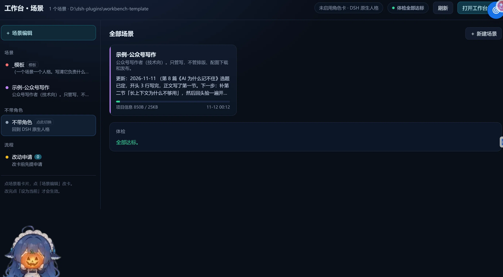
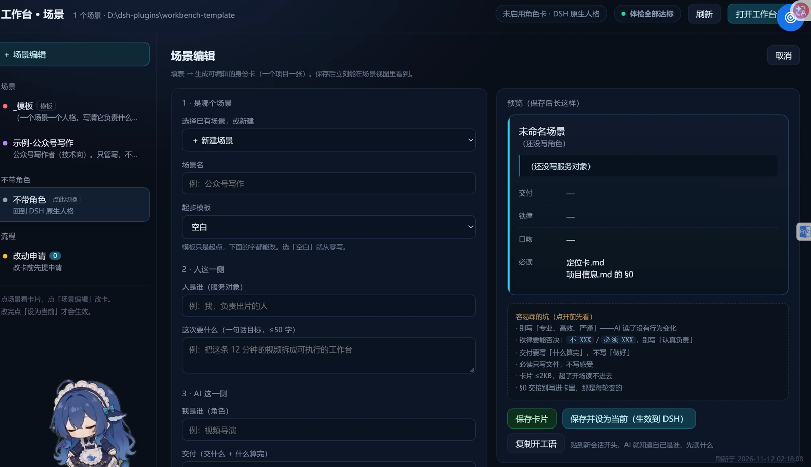

# Agent Workbench Template

> One project, one "scene". Identity, memory, index and hard rules live in plain files — not in the chat history, and not tied to a specific AI tool.



The Chinese README ([README.md](README.md)) is the primary one. This is a short English version.

## The problem

Every new session, the AI starts from zero:

- who it is, what the project is
- what was done last time
- where the files are
- what it must never do

Long projects make it worse: the model silently drops earlier decisions. This template turns those four questions into **four files** the AI reads at the start of every session.

## Minimal setup: three files

```
my-workbench/
├── 00-工作台宪法.md      # the constitution: what to write where, size limits, wrap-up rules
└── 场景/
    └── my-project/
        ├── 身份.md        # identity: who, delivers what, rules, tone
        └── 项目信息.md    # long-term memory; its first section (§0) is "where we left off"
```

Then tell your agent:

> Before anything: read `00-工作台宪法.md`, then `场景/my-project/身份.md` and the `§0` section of `项目信息.md`. Say who you are and where we left off, then start.

## Full structure

```
workbench/
├── README.md
├── AGENTS.md              # entry point for Claude Code / Cursor / DSH
├── 00-工作台宪法.md        # the rules
├── 索引.md                 # scenario registry
├── 路线图.md               # deferred work, so it is not forgotten
├── 场景/
│   ├── _模板/              # copy this to start a new scene
│   └── 示例-公众号写作/     # a filled-in example
├── 工具/
│   ├── 铁律库.md           # candidate rules to pick from
│   ├── 工具清单.md
│   └── 新场景.py           # create a scene: copy template + register
├── 体检/体检.py             # health check
└── 可选-界面/              # optional local UI (Python, no deps)
```

## Four hard rules

1. **One project, one scene.** Scenes never write into each other.
2. **Memory only goes into `项目信息.md`.** Chat logs are not memory. Overwrite `§0` at the end of every session: what is done, what is next, `更新：YYYY-MM-DD`.
3. **Size limits.** `项目信息.md` ≤ 25 KB, `§0` ≤ 4 KB. Older rounds move to `归档/YYYY-MM-DD.md`; the main file keeps a pointer.
4. **Dense folders need an index.** A folder with ≥30 documents, or ≥8 documents and ≥500 KB, must contain `_索引.md`. The agent reads the index before opening anything.

Why 25 KB: that is roughly what a model can read in full at session start without eating the context it needs for actual work. Bigger memory is not "more memory" — it is memory the model no longer holds.

## Health check

```bash
python 体检/体检.py            # writes a report to 体检/报告/
python 体检/体检.py --no-write # print only
```

Checks: stray files in the root, missing scene files, size overruns, missing indexes, unregistered scenes, missing tool registry, stale `§0` (over 7 days). Exit code 1 on any FAIL — wire it into a startup script or a git hook.

## Wiring it to your tool

| Tool | How |
|---|---|
| Claude Code / Codex-like | keep `AGENTS.md` at the repo root |
| Cursor | paste `AGENTS.md` into `.cursor/rules`, or @-mention it |
| DeepSeek Harness (DSH) | inject the card into the project persona file, or paste the one-line kickoff |
| Web chat (no filesystem) | paste the three files into the first message |

## Optional UI

`可选-界面/` contains a local-only web panel (Python standard library, no dependencies): scene list, identity card, `§0`, memory size, health report, plus a form that writes the cards. Double-click `start.bat`. It is a shell only — delete it and no data is lost. It does not require DSH.



## License

MIT.
