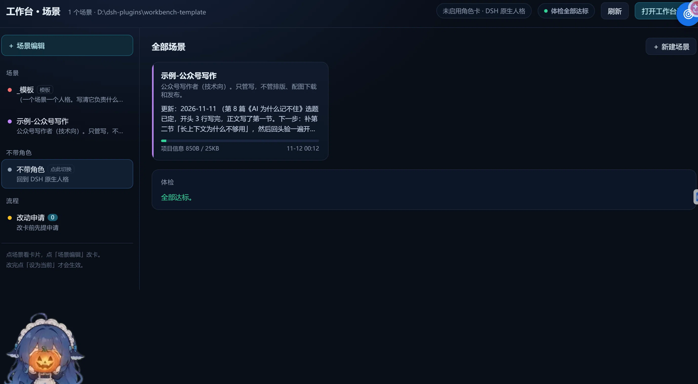
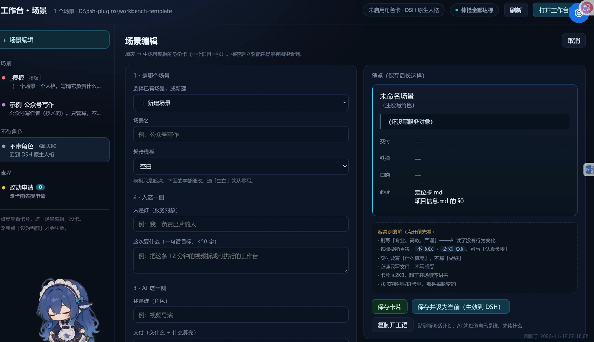

# 工作台模板 · 让 AI 不再每次从零开始

> 一个项目 = 一个场景。身份、记忆、索引、铁律全写在文件里，不靠聊天记录，也不绑死某个 AI 工具。



## 它解决的是这个场面

每次开新会话，你都要重新交代一遍：

- 「我是谁、这个项目在干嘛」
- 「上次做到哪了」
- 「文件都在哪个目录」
- 「什么不许做」

聊到一半，AI 又开始忘前面的事；项目一长，它把早先的结论全丢了。

这套模板把上面四件事**变成文件**，让 AI 每次开工先读四个文件，两分钟接上，不用你重复第三遍。

## 最小可用：三个文件就够

如果不想一上来就搞全，先只做这三件：

```
我的工作台/
├── 00-工作台宪法.md      ← 规矩：什么能写、什么不能写、收工写哪里
└── 场景/
    └── 公众号写作/
        ├── 身份.md        ← 我是谁、交付什么、什么口吻、守什么铁律
        └── 项目信息.md    ← 长记忆：里面第一节 §0 就是「上次做到哪」
```

然后在你的 AI 工具里加一句：

> 开工先读 `00-工作台宪法.md`，再读 `场景\公众号写作\身份.md` 和 `项目信息.md` 的 §0，读完告诉我「你是谁、上次到哪」，再动手。

## 完整结构

```
工作台/
├── README.md                    ← 你在看的这份
├── AGENTS.md                    ← 给 AI 的入口说明（Claude Code / Cursor / DSH 都认这种文件）
├── 00-工作台宪法.md              ← 规矩的总纲，改了它要同步改体检
├── 索引.md                       ← 场景登记表：有哪些场景、放哪、状态
├── 路线图.md                     ← 「以后再做」的任务，免得忘
├── 场景/
│   ├── _模板/                    ← 复制这一份 = 新场景
│   │   ├── 身份.md
│   │   ├── 定位卡.md
│   │   ├── 项目信息.md
│   │   ├── 会话档案.md
│   │   ├── 归档/                 ← 超限的旧轮次剪到这里
│   │   └── 备份/
│   └── 示例-公众号写作/           ← 一个填好的假场景，看「填完长什么样」
├── 工具/
│   ├── 铁律库.md                 ← 候选铁律，拿不准边界时从这里挑
│   ├── 工具清单.md               ← 装了什么，登记在这
│   └── 新场景.py                 ← 一条命令建一个新场景
├── 体检/
│   ├── 体检.py                   ← 查：体积超没超、缺不缺索引、§0 多久没更新
│   └── 报告/                     ← 每次体检自动落一份
└── 可选-界面/                    ← 不装也能用；装了就是点开即用的窗口
    ├── server.py
    ├── index.html
    ├── start.bat
    └── README.md
```

> 这套不含界面。它只是文件，任何 AI 工具都能用。想要点开即用的窗口，见文末「进阶」。

## 三步开始

1. **复制**：把整个目录复制到你想放的位置（别放在 C 盘用户目录里，路径越短越好）。
2. **建第一个场景**：
   ```bash
   python 工具/新场景.py 我的项目 --slug my-project
   ```
   然后照着 `场景/示例-公众号写作/` 的样子，把 `身份.md` 和 `定位卡.md` 填了。
3. **让 AI 认领**：把 `AGENTS.md` 放到你的项目里（或直接在会话开头贴它的内容），第一次开工时让它读宪法 + 四件套。

## 接到不同的工具

| 工具 | 怎么接 |
|---|---|
| Claude Code / Codex 类 | 仓库根目录放 `AGENTS.md`，多数工具会自动读 |
| Cursor | 把 `AGENTS.md` 的内容贴进 `.cursor/rules`，或每次会话开头 @ 这个文件 |
| DeepSeek Harness（DSH） | 把身份卡内容写进项目人格文件，或每次会话贴「开工语」（见下） |
| 网页版聊天（豆包/通义等） | 没有文件系统，就把三个文件的内容直接贴进对话第一条 |

**开工语**（任何工具都能用，一行）：

> 开工。先读 `00-工作台宪法.md` 和当前场景的 `身份.md`/`定位卡.md`/`项目信息.md §0`，然后告诉我你是谁、上次到哪。

## 四条硬规矩

模板里所有设计都是为了这四条，不是为了好看：

1. **一个项目一个场景**：场景目录里只放这个项目的东西，互不串门。
2. **记忆只进 `项目信息.md`**：聊天记录不是记忆。每轮收工把 `§0 当前交接` 覆盖写一遍（做到哪 + 下一步 + `更新：日期`）。
3. **体积有红线**：`项目信息.md` ≤ 25KB，`§0` ≤ 4KB。超了把旧轮次剪进 `归档\YYYY-MM-DD.md`，正文留指针。
4. **文档密集的目录要有 `_索引.md`**：≥30 份文档，或 ≥8 份且 ≥500KB 就必须有。AI 先读索引，再决定翻不翻正文。

为什么是 25KB：这个体积差不多是 AI 开场能完整读进去、又不至于挤掉别的上下文的上限。更大的记忆不是不能用，是**读了也记不住**。

## 体检

```bash
python 体检/体检.py            # 检查 + 写报告到 体检/报告/
python 体检/体检.py --no-write # 只打印，不落盘
```

它查七件事：根目录有没有乱堆文件、场景四件套齐不齐、体积超没超、该建索引的目录有没有索引、场景有没有在 `索引.md` 登记、工具清单在不在、`§0` 多久没更新了（`_模板` 和 `示例-*` 跳过最后一项）。

退出码 0 = 全过，1 = 有 FAIL。可以挂进开机脚本或 git hook，红了就说明规矩破了。

## 示例场景

`场景/示例-公众号写作/` 是一个填好的假场景，用来给你看「填完是什么样」：

- 身份卡不是「专业、高效、严谨」，而是能拿来说「你违反了这条」的话
- 定位卡六项一屏看完
- `项目信息.md` 的 §0 一段话讲清做到哪、下一步

看完可以直接删掉，或者改成你自己的第一个场景。

## 常见坑

| 坑 | 后果 | 怎么躲 |
|---|---|---|
| 身份卡写「专业、高效、严谨」 | AI 读了行为不变，还占体积 | 只写能否决的句子：不 XXX / 必须 XXX / 只 XXX |
| 把聊天记录当记忆 | 越读越乱，还读不完 | 记忆只进 `项目信息.md` |
| 卡片写太长 | AI 开场读不进去 | 卡片 ≤ 2KB，一屏 |
| 什么都往根目录扔 | 找不到、体检报错 | 根目录只放宪法/索引/路线图/场景/工具/体检 |
| 索引不建 | AI 只能瞎翻文件 | 文档密集的目录放 `_索引.md` |

## 进阶（可选）

- **本机面板**：`可选-界面/` 里带了一个点开即用的窗口（场景列表、身份卡、§0、体积、体检，外加填表生成卡片）。它只是壳，删了文件一个不丢；不装也完全能用。启动：双击 `可选-界面/start.bat`。
- **改动申请**：改身份卡之前先写一份 `提案/待处理/*.md`（现状/建议/影响），人点了同意再改，改前自动备份。多人的项目里很管用。
- **人格注入**：DSH 可以把当前场景的卡片摘要写进项目人格文件的标记块里，新会话自动带上；换回「不带角色」就整段删掉。不用 DSH 的人忽略这条。



## 许可

MIT。拿去改，改成你自己的。改完愿意的话提个 issue 说说你加了什么场景。
